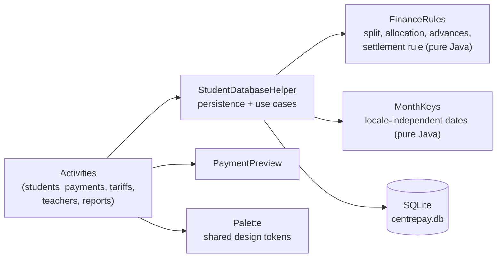

# CentrePay — Android payment management for a tutoring centre

Native Android application (Java, SQLite) that manages the finances of an after-school tutoring centre: students, teachers, subject packs and tariffs, monthly dues, payments and advances, teacher salaries and a monthly cash report.

It runs fully offline on one device, with no backend and no third-party runtime library.

> Academic / portfolio project. All data shown in this repository (tests, examples) is fictitious.

## Features (implemented)

| Area | What the app does |
|---|---|
| Students | Create a student (phones, level 1AC–3AC, subjects), search by name/phone, filter by level, financial sheet with month-by-month history |
| Tariffs | Formulas per level and **exact subject pack** (e.g. Math + Physics), each split into teacher shares (Math, French, Physics-Chemistry, Life Sciences) and a centre share |
| Teachers | Levels and subjects taught; automatic assignment when a single compatible teacher exists, manual choice otherwise |
| Monthly dues | One due per student and month, created from enrolment to the current month. Amounts and teachers are **snapshotted**, so later tariff changes never rewrite history |
| Payments | Payment for a declared month; partial payments; surplus kept as an **advance**; advances automatically cover the following unpaid months up to the current month; payments for a month before enrolment are refused |
| Payment preview | The confirmation screen runs the exact save computation in a rolled-back transaction, so the preview always matches what is recorded |
| Allocation | Every allocated amount is split between teachers and the centre with a largest-remainder method (integer dirhams, nothing lost or created) |
| Payroll | Salary per teacher and month computed **only from money actually collected**; settlements recorded for the full remaining amount, including a later complement when late payments arrive |
| Reports | Dashboard (received, outstanding, advances, teacher share, centre share); monthly report (collected for the month, centre share, salaries due/paid, students still owing) with CSV export |

## Tech stack

- Java 17, Android SDK only (compileSdk / targetSdk 36, minSdk 24)
- SQLite through `SQLiteOpenHelper` (schema version 14, incremental migrations)
- UI built in code with a shared colour palette (WCAG AA contrast checked by a unit test)
- Tests: JUnit 4 and Robolectric (test scope only — nothing is added to the APK)
- Build: Gradle 8.13, Android Gradle Plugin 8.12

## Architecture



The financial rules are pure Java classes without Android dependencies, which makes them testable on the JVM. See [`docs/ARCHITECTURE.md`](docs/ARCHITECTURE.md) for the data model and the payment flow.

## Getting started

Requirements: Android Studio (recent), JDK 17+ (the JDK bundled with Android Studio works), Android SDK Platform 36.

```bash
git clone <repository-url>
cd centrepay-android
# Windows: gradlew.bat ...
./gradlew testDebugUnitTest      # run all unit tests
./gradlew assembleDebug          # build app/build/outputs/apk/debug/app-debug.apk
```

Or open the folder in Android Studio and run the `app` configuration on an emulator or a device.

## Tests

40 automated tests, last run locally on 2026-11-08 with `gradlew clean testDebugUnitTest assembleDebug` → **BUILD SUCCESSFUL, 40 passed, 0 failed**.

| Suite | Tests | Scope |
|---|---|---|
| `FinanceRulesTest` | 13 | Exact / partial / over-payment, no money lost on any amount 0–1000, advances on following months only, settlement complement |
| `MonthKeysTest` | 5 | Date parsing independent of the phone language (incl. Arabic-Indic digits), impossible dates rejected |
| `PaletteTest` | 4 | WCAG AA contrast of every text colour |
| `StudentDatabaseHelperTest` (Robolectric, real SQLite) | 18 | End-to-end payment scenarios, teacher assigned after enrolment, tariff change, salary + late complement, payment before enrolment, preview = recorded result, **forced SQL failure → full rollback**, **schema upgrade 13 → 14 without data loss**, indexes |

Details: [`docs/TESTING.md`](docs/TESTING.md).

## Project status and known limitations

- Single-device, offline application; there is no login screen (access is protected only by the phone lock).
- No end date for a student's enrolment yet: dues are generated every month until the current one.
- Payments cannot be cancelled from the UI.
- Screenshots will be added with synthetic data.

## Privacy

The repository contains no database, APK, screenshot of real users or credentials. `.gitignore` excludes `*.db`, `*.apk`, keystores and local configuration.

## Development notes

Built as a personal/academic project. Parts of the code were produced with the help of AI coding assistants and then reviewed, corrected and tested (see the audit-driven fixes listed in [`docs/CHANGELOG.md`](docs/CHANGELOG.md)).

## License

The original code of this project is released under the [MIT License](LICENSE).

The MIT License does **not** cover third-party material kept in the repository: the Gradle Wrapper (`gradlew`, `gradlew.bat`, `gradle/wrapper/`, Apache License 2.0) and the vector icons `app/src/main/res/drawable/ic_*_24.xml`, based on Google Material Icons (Apache License 2.0). Libraries downloaded at build time keep their own licenses. See [`NOTICE.md`](NOTICE.md).
