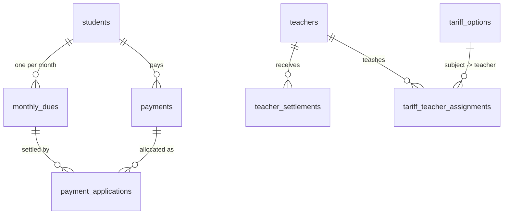
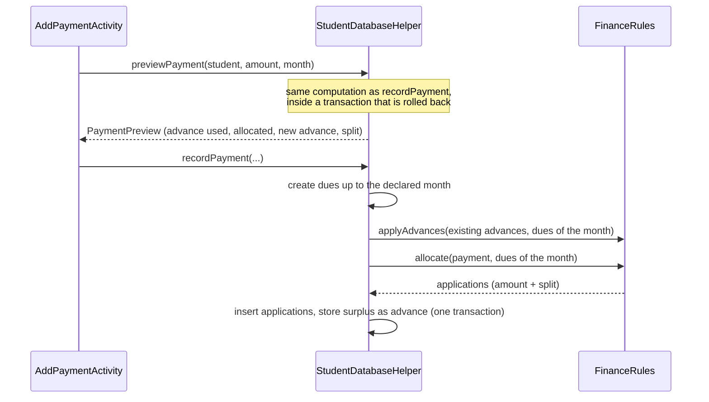

# Architecture

## Packages and classes

All classes live in `com.centrepay.mobile` (`app/src/main/java/com/centrepay/mobile`).

| Layer | Classes |
|---|---|
| Screens | `MainActivity` (dashboard), `StudentListActivity`, `StudentDetailActivity`, `AddStudentActivity`, `TariffActivity`, `TariffTeacherAssignmentActivity`, `TeacherListActivity`, `AddTeacherActivity`, `TeacherSettlementListActivity`, `TeacherMonthlySalaryActivity`, `AddTeacherSettlementActivity`, `PaymentListActivity`, `AddPaymentActivity`, `MonthlyReportActivity`, `BottomTabBar` |
| Persistence and use cases | `StudentDatabaseHelper` (schema, migrations, queries, payment recording, payroll, reports) |
| Pure rules (JVM-testable) | `FinanceRules` (split, allocation, advances, settlement rule), `MonthKeys` (date and month keys) |
| Value objects | `Student`, `Teacher`, `TariffOption`, `PaymentRecord`, `PaymentResult`, `PaymentPreview`, `StudentMonthBalance`, `StudentFinancialSummary`, `TeacherBalance`, `TeacherLevelBalance`, `MonthlyReport`, `MonthlyStudentBalance`, `DashboardSummary` |
| Design | `Palette` (single colour palette), `MosaicAccentView` |

## Data model (SQLite, version 14)

- `monthly_dues` stores a **snapshot** of the amounts and teachers of the month (`UNIQUE(student_id, due_month)`).
- `payments` stores the raw amount, the declared month and the advance still available (`advance_balance`).
- `payment_applications` is the ledger: each row allocates part of a payment (or of an advance) to one due, split into math / french / pc / svt / centre.
- `teacher_settlements` records what was actually paid to a teacher for a month.
- Indexes are created in `onOpen` with `CREATE INDEX IF NOT EXISTS`, which keeps the schema version unchanged.

## Payment flow

On every refresh, `refreshMonthlyDuesAndAdvances` creates the dues up to the current month, links students to teachers assigned to their formula after enrolment (only when no teacher was set), and applies available advances to the following unpaid months.

## Business rules (as implemented)

- The declared month decides where a payment goes; the surplus becomes an advance.
- An advance covers only months **after** the month it comes from, up to the current month.
- A teacher's salary for a month is the sum of collected shares for that teacher; a settlement always pays the whole remaining amount.
- Amounts are integers (dirhams); the split never loses or creates money.
